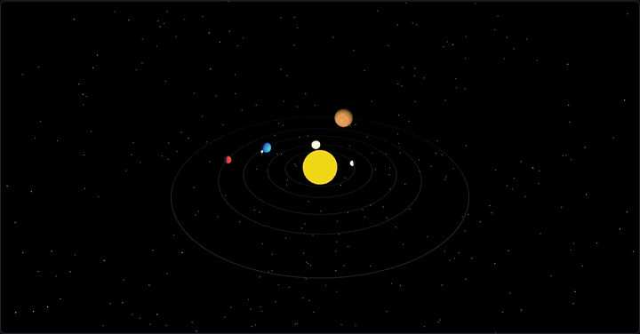
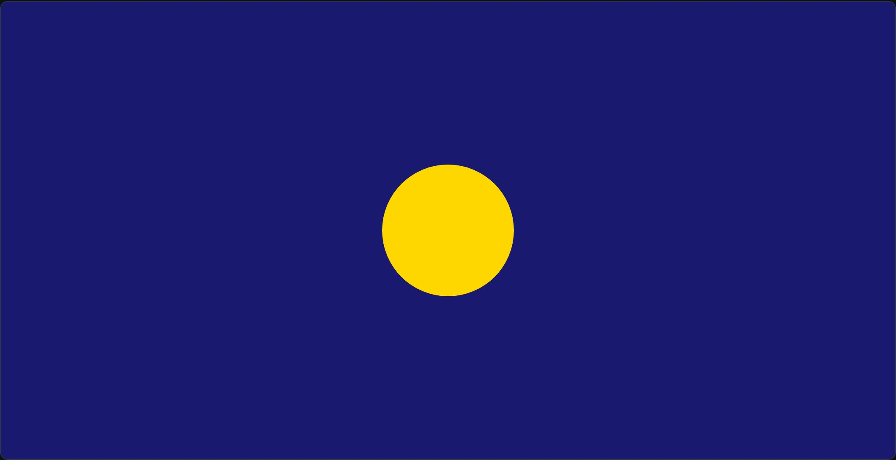
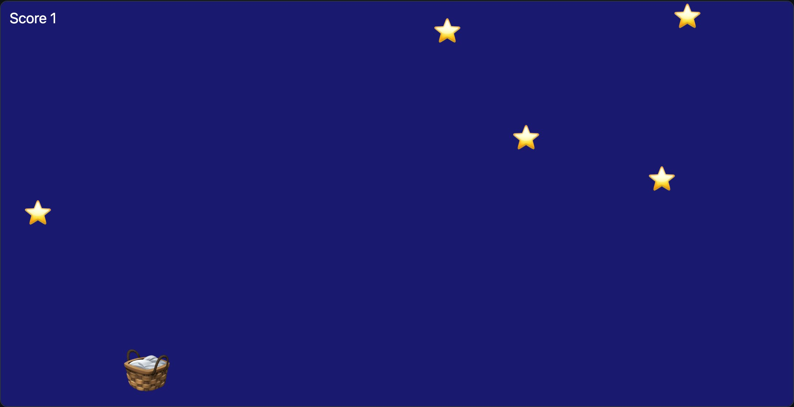
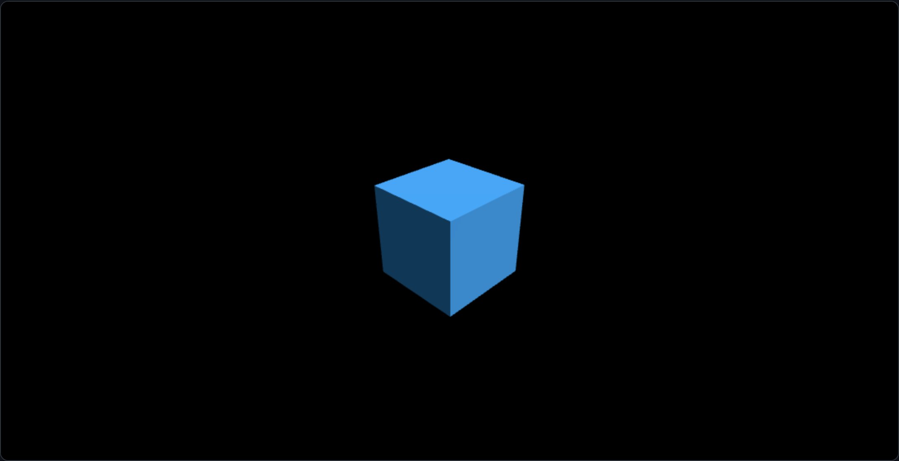
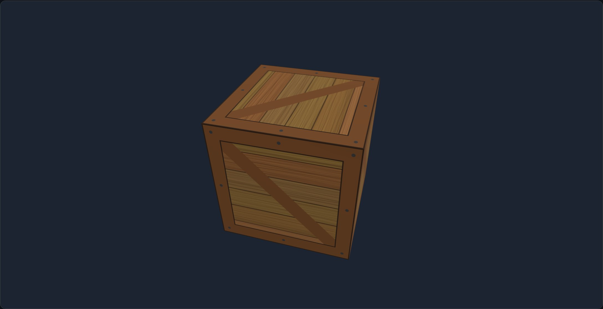

# pictures.js

[](LICENSE)

[](https://www.circuitry.dev/pictures)

**[Change the code and run it on the pictures.js page →](https://www.circuitry.dev/pictures)** Nothing to install.

pictures.js is for making 2D and 3D graphics and games in plain JavaScript, and for enjoying it. It is for any age and any level, a first program or a thousandth: you type a few lines and see something move. It is designed to bring the joy back into programming. Write a short `.js` file and it draws in your web browser: shapes, text, moving sprites, games, animations, live charts and lit 3D scenes. There is no HTML to write: plain drawing functions, the web's 2D canvas and three.js are ready in every file, with nothing to import, no page to make, no canvas to find and no loop to set up. It is designed for projects made in [Circuitry Studio](https://www.circuitry.dev), and runs anywhere a browser does.

Prefer Python? [Pyctures](https://github.com/johnwylie70/pyctures) is the sibling library: the same shape of program (`setup()`, `update(dt)`, `draw()`, `keys`, `mouse`, `Sprite`, three.js) in a `.py` file. A scene comes across from one to the other with little more than its syntax changed.

## Start with four small scenes

Each one is a whole program, a few lines longer than the last. There is nothing to import. [How to run one](#run-it) is just below.

**1. Draw something.** Save this as `hello.js`:

```js
function draw() {
  background("midnightblue")
  circle(width / 2, height / 2, 80, "gold")
}
```



`draw()` is called every frame. `background` paints the whole picture, and `circle(x, y, radius, colour)` draws a circle. `width` and `height` are the size of the picture, so this circle sits in the middle.

**2. Make it move.**

```js
let x = 0

function update(dt) {
  x += 200 * dt              // 200 points every second
  if (x > width) x = 0       // off the right edge: start again on the left
}

function draw() {
  background("midnightblue")
  circle(x, height / 2, 40, "gold")
}
```

`update(dt)` is called before every `draw()`. `dt` is the time since the last frame, in seconds: about a sixtieth of a second on most screens, and less on a faster one. It is there because screens do not all draw at the same rate, and a busy device can drop frames. A program that moved the circle a fixed amount every frame would run faster on one screen than on another. Multiplying by `dt` evens that out: `200 * dt` is 200 points a second everywhere, however many frames that second has. Change the 200 and run it again.

**3. Make it answer you.**

```js
let x = 200, y = 150

function update(dt) {
  if (keys.has("ArrowLeft")) x -= 300 * dt
  if (keys.has("ArrowRight")) x += 300 * dt
  if (mouse.down) {          // a mouse button, or a finger
    x = mouse.x
    y = mouse.y
  }
}

function draw() {
  background("midnightblue")
  circle(x, y, 40, "gold")
}
```

`keys.has("ArrowLeft")` is true while that key is held, and `mouse` is the pointer, or a finger on a touch screen. Click the scene first, so it has the keyboard.

**4. A bit more: a small game.**

```js
const basket = new Sprite("🧺", 200, 250, 64)
const stars = []
for (let i = 0; i < 5; i++) stars.push(new Sprite("⭐", random(400), random(300), 36))
let score = 0

function update(dt) {
  if (mouse.inside) basket.x = mouse.x   // the pointer is over the picture
  basket.y = height - 50
  for (const star of stars) {
    star.y += 200 * dt
    const caught = star.touches(basket)
    if (caught) score += 1
    if (caught || star.y > height) {   // caught or missed: back to the top
      star.x = random(width)
      star.y = 0
    }
  }
}

function draw() {
  background("midnightblue")
  for (const star of stars) star.draw()
  basket.draw()
  text("Score " + score, 12, 30, "white", 20)
}
```



A `Sprite` is a picture that moves, here an emoji, and `touches` says when two of them meet. Move the mouse, or drag a finger, to catch the stars.

These four are in the examples folder as `hello.js`, `moving.js`, `follow.js` and `first_game.js`. The tutorials carry on from here: [your first drawing](docs/tutorials/first-drawing.md), [a bouncing ball](docs/tutorials/bouncing-ball.md), [a simple game](docs/tutorials/game.md) and [Space Rocks](docs/tutorials/space-rocks.md). The plain functions (`background`, `circle`, `rect`, `line`, `text`) cover a first picture; for everything else there is `ctx`, the web's own 2D drawing surface ([Drawing in 2D](docs/drawing-2d.md)). `save("best", score)` keeps a value and `load("best", 0)` gives it back the next time the scene runs ([Saved values](docs/saved-values.md)).

## Install

You need [Node.js](https://nodejs.org). In the folder where your scenes are:

```bash
npm install pictures.js
```

That gives the folder the `pictures` command, which is run with `npx`.

## Run it

```bash
npx pictures run hello.js
```

Your browser opens on the scene. Save the file and the scene runs again. Errors are shown on the scene with the line they happened on.

Options: `--port 9000`, `--no-browser`.

From a copy of this repository there is nothing to install: the same command is `node bin/pictures.mjs`, as in `node bin/pictures.mjs run examples/hello.js`.

## Share it

```bash
npx pictures build hello.js -o site/
```

`site/` is a folder of plain files that runs the scene in any browser. Put it on any static host. Everything in the scene's folder goes with it, so pictures the scene loads by a relative path, such as `loadImage("textures/brick.png")`, are there too.

## Use it on your website

Put scenes straight into your page, as many as you like:

```html
<div data-pictures-src="balls.js"></div>
<div data-pictures-src="knot.js" style="height: 420px"></div>
<script type="module" src="pictures/pictures.js"></script>
```

Each canvas fills its box (16:9 if the box has no height) and waits while it is scrolled out of view. Each scene has its own names and its own state. See [Use it on your website](docs/website.md), and the two-scene page in [`examples/website`](examples/website).

## The same shape as Pyctures

| | Python (Pyctures) | JavaScript (pictures.js) |
|---|---|---|
| Every frame | `def update(dt):` `def draw():` | `function update(dt) {}` `function draw() {}` |
| Once, first | `def setup():` | `function setup() {}` |
| A loop | `await frame()`, or `await vsync()` | `await frame()`, or `await vsync()` |
| A pause | `await sleep(1)` | `await sleep(1)` |
| Size | `width`, `height`, `pixel_ratio` | `width`, `height`, `pixelRatio` |
| Keys held | `"ArrowLeft" in keys` | `keys.has("ArrowLeft")` |
| Keys, once a press | `" " in pressed`, `"a" in released` | `pressed.has(" ")`, `released.has("a")` |
| Modifier keys | `keys.shift`, `keys.ctrl`, `keys.alt`, `keys.meta` | the same |
| Pointer | `mouse.x`, `mouse.y`, `mouse.down`, `mouse.button`, `mouse.inside`, `mouse.dx`, `mouse.dy`, `mouse.wheel` | the same |
| Every finger | `for touch in touches:` with `touch.x`, `touch.y`, `touch.start_x`, `touch.dx`, `touch.id` | `for (const touch of touches)` with `touch.x`, `touch.y`, `touch.startX`, `touch.dx`, `touch.id` |
| Two-finger zoom | `pinch.scale`, `pinch.change` | the same |
| Events | `on_key_down(key, code)`, `on_mouse_down(x, y, button)`, `on_touch_start(touch)`, `on_wheel(amount)`, `on_pinch(scale, change)` | `onKeyDown(key, code)`, `onMouseDown(x, y, button)`, `onTouchStart(touch)`, `onWheel(amount)`, `onPinch(scale, change)` |
| An angle in degrees | `degrees(90)` | the same |
| Plain drawing | `background("navy")`, `circle(x, y, 40, "gold")`, `rect(x, y, w, h)`, `ellipse`, `triangle`, `polygon`, `star`, `line`, `text("Hi", x, y)`, `picture("🌙", x, y, 60)` | the same |
| An outline | `circle(x, y, 40, "gold", outline="white", thickness=3)` | `circle(x, y, 40, "gold", { outline: "white", thickness: 3 })` |
| Chance | `random(1, 6)`, `random()`, `pick(colours)` | the same |
| Pictures | `Sprite("🚀", x, y, size=48)`, `load_image("a.png")` | `new Sprite("🚀", x, y, 48)`, `loadImage("a.png")` |
| Plain shapes | `Sprite.box(x, y, 80, 16, "red")`, `Sprite.circle(x, y, 20)` | the same, with no `new` |
| A picture you draw | `Sprite(draw_ship, x, y)` with `def draw_ship(size):` | `new Sprite(drawShip, x, y)` with `function drawShip(size) {}` |
| Sprites that touch | `a.touches(b)`, `rock = ship.hit(rocks)`, `a.contains(mouse)` | the same |
| Moving a sprite | `wrap()`, `bounce("top", "bottom")`, `offscreen()`, `push(n)`, `forward(n)`, `limit(n)`, `spin`, `angle_to(b)`, `distance_to(b)` | the same, with `angleTo(b)`, `distanceTo(b)` |
| Out of a list | `for rock in rocks[:]:` and `remove(rocks, rock)` | `for (const rock of [...rocks])` and `remove(rocks, rock)` |
| Saved values | `save("best", 120)`, `best = load("best", 0)` | the same |
| Files beside the scene | `open("words.txt")` | `await loadText("words.txt")`, `await loadJSON("level.json")` |
| Writing a file | `save_text("notes.txt", text)`, `text = load_text("notes.txt", "")` | `await saveText("notes.txt", text)`, `text = await loadText("notes.txt")` |
| A database | `db = open_database("scores")`, `db.query(sql, 10)`, `db.run(sql, "Ann", 12)`, `db.close()` | `db = await openDatabase("scores")`, then the same calls with `await` |
| 3D | `THREE.Mesh(g, m)`, `addons.OrbitControls(camera, canvas)` | `new THREE.Mesh(g, m)`, `new addons.OrbitControls(camera, canvas)` |
| Reading a value | `w = await ctx.measure_text("Hi").width` | `const w = ctx.measureText("Hi").width` |

The Python spellings (`pixel_ratio`, `load_image`, `on_key_down`) work in JavaScript too. The scene's code calls the canvas directly, so values read back at once and nothing is recorded or replayed.

```python
# Python
cube = THREE.Mesh(THREE.BoxGeometry(1, 1, 1),
                  THREE.MeshStandardMaterial(color=0x44aaff))
scene.add(cube)

def draw():
    cube.rotation.y += 0.01
    renderer.render(scene, camera)
```

```js
// JavaScript
const cube = new THREE.Mesh(new THREE.BoxGeometry(1, 1, 1),
                            new THREE.MeshStandardMaterial({ color: 0x44aaff }))
scene.add(cube)

function draw() {
  cube.rotation.y += 0.01
  renderer.render(scene, camera)
}
```



That is the heart of [`examples/from_python_3d.js`](examples/from_python_3d.js). The full guide, with a 2D and a 3D example side by side: [Bringing a Pyctures scene across](docs/from-python.md).

## A 3D scene, with a picture from a file

A cube with a picture wrapped round it. Put the picture beside your scene, here `textures/crate.png`:

```js
const renderer = new THREE.WebGLRenderer({ canvas, antialias: true })
renderer.setPixelRatio(pixelRatio)
renderer.setSize(width, height, false)
const scene = new THREE.Scene()
scene.background = new THREE.Color(0x1b2430)
const camera = new THREE.PerspectiveCamera(50, width / height, 0.1, 100)
camera.position.set(0, 1.2, 4)
const controls = new addons.OrbitControls(camera, canvas)

const texture = new THREE.TextureLoader().load("textures/crate.png")
texture.colorSpace = THREE.SRGBColorSpace
const crate = new THREE.Mesh(new THREE.BoxGeometry(1.6, 1.6, 1.6), new THREE.MeshStandardMaterial({ map: texture }))
scene.add(crate)

const light = new THREE.DirectionalLight(0xffffff, 2.5)
light.position.set(3, 4, 5)
scene.add(light)
scene.add(new THREE.AmbientLight(0xffffff, 0.6))

function draw() {
  crate.rotation.y += 0.008
  crate.rotation.x = 0.35
  camera.aspect = width / height
  camera.updateProjectionMatrix()
  renderer.setSize(width, height, false)
  controls.update()
  renderer.render(scene, camera)
}
```



`THREE` is three.js, ready to use, and `addons.OrbitControls` lets you drag to turn the scene. This is [`examples/textured_cube.js`](examples/textured_cube.js).

## Files and databases

A scene can write a file and read it back the next time, and keep rows in a SQLite database:

```js
await saveText("notes.txt", "remember the milk")
const notes = await loadText("notes.txt")

const db = await openDatabase("scores")
await db.run("create table if not exists best (name text, points integer)")
await db.run("insert into best values (?, ?)", "Ann", 12)
const rows = await db.query("select name, points from best where points > ?", 10)   // [{ name: "Ann", points: 12 }]
```

On a web page the browser keeps them, for that scene alone. An app that runs scenes can keep them as real files on the device. SQLite is loaded the first time a scene opens a database, and not at all by a scene that opens none. See [Files and databases](docs/files-and-databases.md), and [`examples/top_scores.js`](examples/top_scores.js).

## Changing a picture

pictures.js loads and draws pictures. The methods that change one (`await img.removeBackground()`, `await img.resize({ width: 800 })`, `await img.trace()` and more) are not part of this library: the app that runs a scene supplies them and does the work. [Circuitry Studio](https://www.circuitry.dev/docs/pictures/images) does, so a scene there can cut out a subject, resize, crop, trace a picture into shapes and read what is in it. On a page of your own, and in a page made with `pictures build`, a picture still loads and draws, and calling one of these stops the scene with a message that says they work inside Circuitry. An app of your own can supply them with the `pictures` option: see [Use it on your website](docs/website.md#picture-methods).

## Examples

In [`examples/`](examples), each with a comment at the top saying what it shows. `node scripts/build-gallery.mjs` builds a gallery of them all in `site/`, each running with its code beside it.

| File | What it is |
|---|---|
| `star_catcher.js` | A 2D game with sprites, a score and lives |
| `space_rocks.js` | Space Rocks: steer a ship and shoot the rocks, which break in two and wrap round the edges |
| `bat_and_ball.js` | Bat and Ball: one player against the computer |
| `brick_breaker.js` | Brick Breaker: a bat, a ball and a wall of bricks |
| `snake.js` | Snake: a game on a grid, with a best score that is kept |
| `high_score.js` | A best score that is still there next time: `save` and `load` |
| `top_scores.js` | Every game kept in a SQLite database, and the five best shown: `openDatabase` |
| `cube_dodge.js` | A 3D game: dodge the oncoming blocks |
| `lit_scene.js` | Shapes on a floor with a spotlight and shadows |
| `bouncing_balls.js` | A 2D animation with trails; click to add balls |
| `solar_system.js` | Planets, a moon and 2,000 stars in 3D |
| `live_chart.js` | A live line chart with a readout under the mouse |
| `textured_cube.js` | A picture from a file, wrapped round a cube |
| `cube_spiral.js`, `wave_grid.js`, `torus_knot.js` | 3D: a rainbow spiral of 400 cubes, a wave of 225 cubes, a lit knot |
| `starfield.js`, `spiral_garden.js` | 2D: fly through stars, dots on the golden angle |
| `type_and_measure.js` | Keyboard input, and measuring text |
| `from_python_2d.js`, `from_python_3d.js` | Pyctures scenes written in JavaScript |
| `hello.js`, `moving.js`, `follow.js`, `first_game.js` | The four small scenes at the top of this page |
| `night_sky.js` | A whole picture from the plain drawing functions, with no `ctx` |
| `ring.js`, `pulse_loop.js`, `cube.js` | Twelve circles in a ring, a loop with `await frame()`, a plain lit cube |
| `website/` | A web page with two scenes on it |

```bash
node bin/pictures.mjs run examples/star_catcher.js
```

Every one of these is also a [Pyctures example](https://github.com/johnwylie70/pyctures/tree/main/examples) with the same name, so you can read the two side by side.

## Docs

Start with [Getting started](docs/getting-started.md), then [how a program is shaped](docs/program-shape.md), [drawing in 2D](docs/drawing-2d.md), [3D scenes](docs/3d.md), [colours](docs/colours.md), [saved values](docs/saved-values.md), [files and databases](docs/files-and-databases.md), and [tips](docs/tips.md). The [2D functions](docs/2d-functions.md) and [3D functions](docs/3d-functions.md) pages list everything, one line each. The [function index](docs/function-index.md) names every function by area, with a link to where it is explained. Seven tutorials are in [docs/tutorials](docs/tutorials).

## pictures.js in Circuitry Studio

pictures.js comes from [Circuitry Studio](https://www.circuitry.dev), where a JavaScript scene runs in a code editor with a live preview beside the code, and the footer's video button records it at a steady 30 or 60 frames a second. It runs on phones, iPad, the web and desktop. Scenes written with this library run there unchanged, and the other way round.

Its page, where you can edit a scene and run it: [circuitry.dev/pictures](https://www.circuitry.dev/pictures).

## Licence

MIT. See [LICENSE](LICENSE). pictures.js includes three.js (MIT); see [three/LICENSE](three/LICENSE). It includes sql.js, SQLite built for the browser (MIT); see [sqlite/LICENSE](sqlite/LICENSE).

Author: John Wylie
